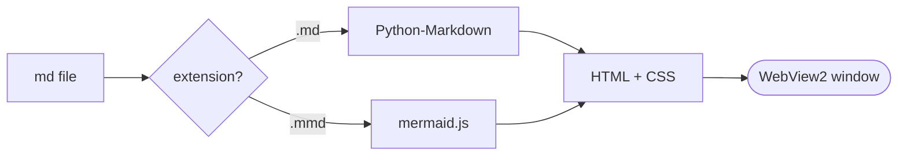
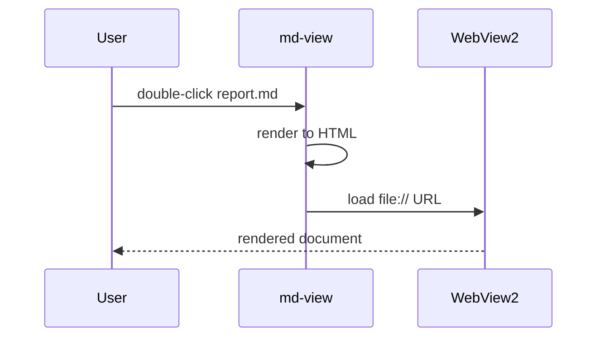

# md-view demo

A **read-only** viewer for Markdown, Mermaid, SVG and images. Zoom with
<kbd>Ctrl</kbd>+<kbd>+</kbd> / <kbd>Ctrl</kbd>+<kbd>-</kbd>, reset with <kbd>Ctrl</kbd>+<kbd>0</kbd>.

## Mermaid, inline



A sequence diagram, to prove more than one diagram type works:



## Code, with highlighting

```python
def render_markdown(text: str) -> tuple[str, str]:
    md = markdown.Markdown(extensions=["extra", "toc", "codehilite"])
    return md.convert(text), md.toc
```

```json
{ "zoom": 1.25, "theme": "dark", "fit": true }
```

## Tables

| Extension | Renderer | Zoom behaviour |
|-----------|----------|----------------|
| `.md`     | Python-Markdown | reflows text |
| `.mmd`    | mermaid.js      | vector, crisp |
| `.svg`    | WebView2        | vector, crisp |
| `.png`    | WebView2        | pan and scale |

## Lists and tasks

- [x] Markdown rendering
- [x] Mermaid sketches
- [x] Images and SVG
- [x] Zoom
- [ ] Editing — deliberately out of scope

1. Ordered items
2. work as expected
   1. including nesting

## Quotes and admonitions

> Reload happens automatically when the file changes on disk, so you can keep
> this window open next to your editor.

!!! note "Offline diagrams"
    Run `md-view.py --fetch-assets` once to cache `mermaid.min.js` locally.

!!! warning
    There is no edit mode. That is the point.

---

Term
:   Definition lists come from the `extra` extension.

Inline `code`, ~~not struck~~, *emphasis*, **strong**, and a [relative link to
the sketch](flow.mmd) that opens in this same window.
